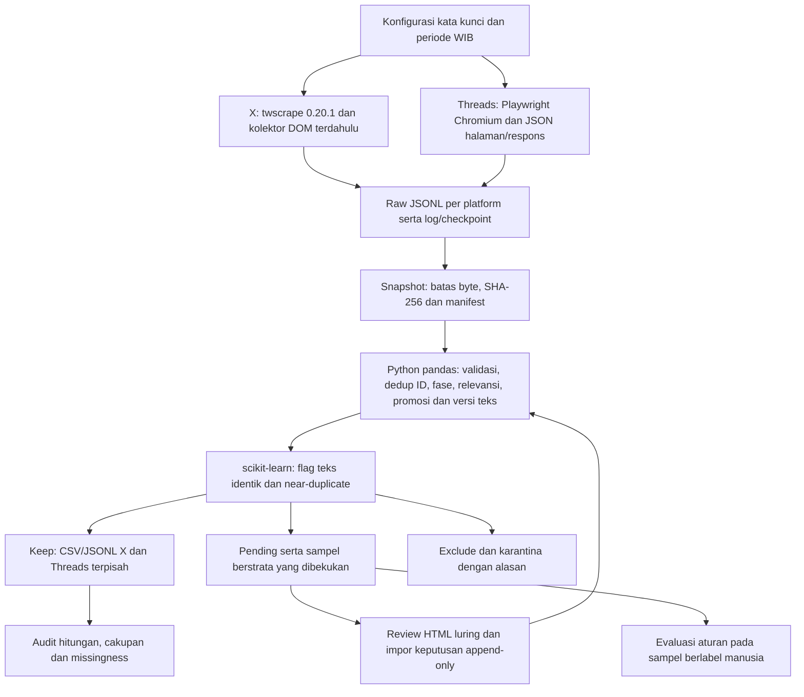

# MagangHub — Panduan Penyusunan Laporan Akhir TK 2

Repo ini memuat pengumpulan, preprocessing, review manusia, dan audit data untuk penelitian **“Analisis Pro Kontra Publik terhadap Program Magang Nasional MagangHub pada Media Sosial X”**, CSIE604284 Analitika Media Sosial, Fasilkom UI, Gasal 2026/2027. README ini menjadi panduan bagi penyusun dokumen akhir TK2: apa yang ditulis, angka yang dipakai, bukti pendukung, dan batas klaimnya.

**Diperbarui 27 Oktober 2026 berdasarkan isi repo pada commit `ba3ee71`.** Acuan data adalah snapshot **`20261026_3067bfd95e`**, dibekukan **26 Oktober 2026 pukul 23:05 WIB**, dengan keluaran setelah review putaran pertama. Waktu snapshot adalah waktu pembekuan input, bukan waktu seluruh review selesai. X menjadi korpus utama dan Threads pelengkap; keduanya diproses dengan perangkat yang sama tetapi disimpan terpisah. Belum ada hasil BERTopic atau klasifikasi sentimen.

## 1. Mulai membaca dari sini

1. Baca ringkasan tugas dan peta isi A–C7 pada bagian 2–3.
2. Gunakan angka pada bagian 4 dan [laporan kualitas acuan](data/processed/preprocess_20261026_3067bfd95e/LAPORAN_KUALITAS.md). Jangan mencampur keluaran antarversi.
3. Gunakan diagram dan spesifikasi pada bagian 5 untuk C2–C3, lalu review/presisi pada bagian 6 untuk C4–C5.
4. Ambil tabel dari berkas yang dipetakan pada bagian 8. Untuk menulis laporan, **tidak perlu menjalankan kolektor atau memasukkan cookie**.
5. Periksa keterbatasan, reproduksi dan checklist sebelum ekspor PDF.

### Dokumen dan petunjuk pendamping

| Sumber | Peran dan batas penggunaan |
|---|---|
| `../TK2/TK-2--Data-Collection-Pipeline.pdf` | Ketentuan resmi tugas dan struktur laporan |
| `../TK2/acm_formatted_document_template_v2.docx` | Template laporan yang wajib dipertahankan |
| `../TK2/TK1_zhangg.docx` | Konteks, RQ dan literatur awal; fakta kebijakan dan kronologi tetap diperiksa |
| [README_PREPROCESSING.md](README_PREPROCESSING.md) | Spesifikasi preprocessing aktif, versi teks, review dan audit |
| [README_TWSCRAPE.md](README_TWSCRAPE.md) | Operasional kolektor X; parameter run aktual tetap merujuk log/checkpoint |
| [Alat review](alat_review/README.md) | Pengisian label luring, estimator presisi dan kappa |
| [CATATAN_METODE_TK2.md](CATATAN_METODE_TK2.md) | Justifikasi terhadap RQ/materi; **angka dan status review di dokumen ini masih mengacu snapshot lama** |
| [README_MANDIRI.md](README_MANDIRI.md) | Jalur alternatif ekstensi Brave, bukan deskripsi seluruh korpus final |

Folder `../TK2/` berada di luar repo Git ini; cloning repo tidak otomatis menyertakannya. Panduan lama di folder tersebut masih menggambarkan rencana API resmi sebelum pengumpulan, sehingga tidak dipakai untuk menjelaskan implementasi aktual. Draf DOCX milik rekan tetap menjadi dokumen terpisah.

## 2. Ketentuan tugas yang perlu dipenuhi

Menurut soal TK2, tugas melanjutkan TK1 dengan kelompok yang sama. Laporan menggunakan template tanpa memodifikasinya, panjang yang direkomendasikan **1.500–2.000 kata di luar referensi**, dan sitasi berformat **ACM**. Diagram pipeline beserta teknologi utama wajib ada pada C2. Kode pengumpulan wajib tersedia pada repository online yang dapat diakses publik; cantumkan tautannya pada C3.

Remote repo: **<https://github.com/flihid/maganghub-pipeline>**. Periksa akses publik dan kesesuaian commit yang diunggah sebelum submission; keberadaan remote lokal bukan bukti akses publik sudah diuji.

Tenggat yang tercantum pada soal adalah **28 Oktober 2026 pukul 23:59:59**, melalui slot SCeLE pada soal. Dokumen **wajib PDF**; soal menyatakan format selain PDF mendapat nilai 0. Bobot akhir: laporan 30%, implementasi pipeline 40%, peer review 30%.

## 3. Peta isi laporan A–C7

Rentang kata berikut mengikuti rekomendasi soal. Bahan dalam repo lebih panjang daripada laporan; pilih bukti yang paling menjelaskan keputusan dan dampaknya terhadap RQ.

| Bagian | Kata | Isi dan bukti yang disarankan |
|---|---:|---|
| A1 Permasalahan penelitian | 60–80 | Ringkas masalah persepsi publik tentang MagangHub; bedakan kekhawatiran publik dari dampak ketenagakerjaan yang terbukti |
| A2 Kesenjangan penelitian | 50–70 | Kesenjangan yang didukung literatur TK1; hindari klaim “belum pernah diteliti” tanpa dasar |
| A3 Tujuan penelitian | 30–50 | Pemetaan topik, sentimen dan pergeseran temporal sebagai tujuan analisis lanjutan |
| A4 Pertanyaan penelitian | 30–50 | Tiga RQ yang konsisten dengan tabel di bawah |
| A5 Pendekatan analitika | 80–120 | Rencana BERTopic dan model sentimen berbasis IndoBERT beserta alasan; belum merupakan hasil TK2 |
| A6 Kontribusi | 50–80 | Bedakan kontribusi yang diharapkan dari capaian nyata pipeline dan dataset yang dapat diaudit |
| B Ulasan literatur | 200–300 | Pilih literatur TK1 dan dasar keputusan metode; cocokkan ulang nomor sitasi dan metadata ACM |
| C1 Kebutuhan data | 150–200 | Platform dan perannya, konten sasaran, kueri, periode, atribut/metadata, lingkup geografis, target versus volume aktual, inklusi/eksklusi; sertakan tabel RQ → data → alasan |
| C2 Pipeline pengumpulan data | 200–250 | Diagram pada bagian 5 dan uraian tahapan, teknologi, penyimpanan, snapshot, review dan audit |
| C3 Metode pengumpulan data | 200–250 | Akses/autentikasi, kueri aktual, pagination, batas/jeda, error/resume, timestamp, format dan lokasi penyimpanan; beri justifikasi dan tautan repo |
| C4 Implementasi nyata | 200–250 | Snapshot, tabel jumlah pada bagian 4, review yang benar-benar dilakukan, contoh output aman, provenance dan hasil pemeriksaan |
| C5 Kualitas dan keterbatasan | 100–150 | Prioritaskan batas presisi satu peninjau, Threads belum terukur, bias cakupan dan indikasi kampanye; jelaskan dampak pada RQ dan mitigasi |
| C6 Pertimbangan etika | 100–150 | Minimalisasi, pseudonimisasi, kredensial lokal, publikasi raw yang masih beridentitas, ketentuan platform serta akses/retensi |
| C7 Penutup | 100–150 | Ringkas capaian pengumpulan, bagaimana mendukung RQ, dan batas yang tersisa; jangan mengarang hasil model |

Judul C4 pada soal mengulang “Metode Pengumpulan Data”, tetapi deskripsinya meminta implementasi nyata. Pertahankan penomoran/template dan bedakan C3 (cara serta alasan) dari C4 (bukti pelaksanaan).

### Hubungan RQ dengan kebutuhan data

| RQ dari TK1 (diringkas) | Kebutuhan yang dipenuhi pipeline | Batas interpretasi |
|---|---|---|
| RQ1: topik dukungan/keberatan, termasuk persepsi substitusi tenaga kerja dan eksploitasi | Teks relevan, `text_embedding`, `text_topic_repr`, grup teks identik/near-duplicate | BERTopic belum dijalankan; unggahan membuktikan adanya persepsi, bukan hubungan kausal di pasar kerja |
| RQ2: distribusi sentimen per topik dan klaster resistensi | `text_sentiment`, sampel anotasi, metadata jenis akun | Keluhan proses tidak otomatis sikap menolak kebijakan. Sentimen, stance dan objek/aspek perlu dibedakan |
| RQ3: perubahan komposisi topik/sentimen antarperiode | Timestamp WIB, fase, distribusi tanggal dan audit cakupan | Perubahan jumlah terambil dipengaruhi pencarian serta filter; bukan ukuran langsung volume percakapan |

Threads merupakan perluasan pelengkap terhadap RQ yang semula berfokus pada X. Jelaskan keputusan perluasan tersebut jika dipakai dalam laporan; angka gabungan bukan alasan untuk menyebut kedua platform setara atau memperluas klaim menjadi opini nasional. Tidak ada filter geografis tervalidasi; bahasa kueri tidak membuktikan kewarganegaraan atau domisili.

## 4. Angka acuan setelah review putaran pertama

Seluruh angka final di bawah berasal dari `data/processed/preprocess_20261026_3067bfd95e/`. `model_ready` berarti status `keep` setelah aturan dan keputusan manusia yang tersedia diterapkan; **bukan berarti semua baris sudah diperiksa manusia atau merupakan gold standard**.

| Tahap/status | X utama | Threads pelengkap | Jumlah aritmetis |
|---|---:|---:|---:|
| Record mentah / post unik | 5.257 | 6.028 | 11.285 |
| Karantina invalid | 0 | 0 | 0 |
| Model-ready / keep | **4.263** | **3.190** | **7.453** |
| Pending | 20 | 0 | 20 |
| Exclude | 974 | 2.838 | 3.812 |
| Post unik yang mendapat keputusan manusia | 232 | 20 | 252 |
| Keep tanpa akun resmi/media terdaftar | 4.162 | 2.992 | 7.154 |
| Keep, satu wakil per teks identik | 4.234 | 3.090 | 7.324 |

Rekonsiliasi: **5.257 = 4.263 + 20 + 974** dan **6.028 = 3.190 + 0 + 2.838**. Tidak ada ID ganda yang perlu digabung pada snapshot ini; deduplikasi tetap merupakan tahap pipeline. Subset alternatif berasal dari korpus keep dan tidak dijumlahkan sebagai data tambahan. “Tanpa akun resmi/media terdaftar” belum menjamin semua sisanya akun individu.

**7.453 adalah penjumlahan dua korpus, bukan bukti bahwa ada satu dataset gabungan yang telah diseragamkan.** Kriteria relevansi berbeda dan identitas penulis lintas platform tidak dipadankan. Jumlah hash penulis 2.651 di X dan 3.881 di Threads tidak dapat ditafsirkan sebagai 6.532 orang berbeda.

### Periode, fase dan hasil penyaringan

Interval menggunakan **[awal 00:00 WIB, akhir 00:00 WIB)**. Nama/batas fase berasal dari rancangan TK1 dan sumber berita yang dikutipnya; belum diverifikasi sebagai kronologi resmi program. Periksa tahun/angkatan sebelum menulis label fase sebagai fakta resmi.

| Fase operasional | Tanggal yang termasuk | Hari | X unik | X keep | Threads unik dalam jendela | Threads keep |
|---|---|---:|---:|---:|---:|---:|
| Pengumuman | 1 Juli–31 Agustus 2026 | 62 | 2.473 | 2.345 | 1.173 | 729 |
| Seleksi | 1–20 September 2026 | 20 | 936 | 895 | 1.056 | 643 |
| Penempatan | 21 September–25 Oktober 2026 | 35 | 1.848 | 1.023 | 3.660 | 1.818 |
| Total dalam periode | 1 Juli–25 Oktober 2026 | 117 | 5.257 | 4.263 | 5.889 | 3.190 |

Ada **139 post Threads di luar periode**, sehingga total raw Threads tetap 6.028. Jumlah keep kedua platform per fase adalah 3.074, 1.538 dan 2.841 (41,2%, 20,6%, 38,1% dari penjumlahan keep). Sebutkan penyebut dan perbedaan lama fase jika angka itu dipakai.

Retensi X fase 3 adalah **55,4%**, dibandingkan fase 1 94,8% dan fase 2 95,6%. Proporsi fase 3 berubah dari 35,2% sebelum filter menjadi 24,0% korpus keep. Jangan menafsirkan perubahan ini sebagai turunnya diskusi atau resistensi publik.

### Eksklusi dan pending yang dapat ditelusuri

| Alasan utama X | Jumlah |
|---|---:|
| Otomatis: tanpa bukti teks relevan | 478 |
| Otomatis: promosi/jasa/lowongan mitra (seluruh kategori promosi) | 396 |
| Manusia: iklan | 61 |
| Manusia: tidak relevan | 39 |
| Total exclude | 974 |

Dari 20 pending X, 19 disebabkan relevansi `ragu` dan 1 promosi `ragu` oleh peninjau. Seluruh 52 kasus pada antrean otomatis sebelumnya sudah dibaca; “sudah dibaca” tidak selalu berarti sudah dapat diputuskan.

Exclude Threads: 1.421 tanpa bukti teks, **1.089 relevansi konteks tidak dipakai**, 139 di luar periode, 124 pengumuman lowongan mitra, 36 akun `meta.ai`, 13 iklan menurut manusia dan 16 kategori promosi otomatis lainnya. Totalnya 2.838. Tidak ada pending Threads; ini tidak berarti seluruh 6.028 baris sudah ditinjau manusia.

Gunakan `alasan_utama` dan `tahapan_*.csv` agar kategori saling lepas. Tabel relevansi × promosi menyajikan sinyal yang tumpang tindih dan bukan sumber untuk menjumlahkan eksklusi final.

## 5. Pipeline dan spesifikasi untuk C2–C3

Diagram ini menggambarkan alur aktif. Gambar ulang dengan caption yang terbaca pada PDF; pertahankan teknologi, penyimpanan dan umpan balik review.



### Pengumpulan aktual

| Aspek | X | Threads |
|---|---|---|
| Akses | `twscrape_pipeline.py`, pencarian internal X menggunakan sesi akun lokal; bukan API resmi X v2 | `02_scrape_threads.py`, Playwright dengan sesi login lokal |
| Asal raw | 5.128 post `twscrape_0.20.1`; 129 dari `connected_brave_dom_v1/v2` | 6.028 post `threads_playwright` |
| Pencarian | Satu kueri OR lima variasi, `lang:in`, Latest, interval harian WIB | Lima kata kunci terpisah pada tab Terbaru; tanggal/bahasa tidak difilter melalui pencarian seperti X |
| Pagination/ekstraksi | Stream SDK per hari; 129 record DOM terdahulu memiliki metadata lebih sedikit | Infinite scroll; baca JSON tertanam dan respons dinamis, bukan class HTML acak |
| Batas/jeda | Default kode 300 ID layak/hari dan 30 halaman; pernah ada pass 600. Jeda minimal 5 detik/halaman dan 25 detik/kueri | Batas post/kueri, 6 scroll tanpa hasil baru, 3 putaran sebelum awal periode, atau 429; jeda scroll 5–9 detik dan antarkueri 25–50 detik |
| Kegagalan | Log/checkpoint menyimpan status, galat dan batas; resume tidak membuktikan kelengkapan | 11 putaran pengumpulan: 5 hasil habis, 4 batas maksimum, 2 terkena 429 |
| Penyimpanan | `data/raw/x_<fase>.jsonl` (3 file), log dan checkpoint | `data/raw/threads_<kata>.jsonl` (5 file), log/progres |

Kueri dasar X:

```text
(maganghub OR "magang hub" OR "magang nasional" OR "magang kemnaker" OR "pemagangan nasional") lang:in since_time:<unix_awal_WIB> until_time:<unix_akhir_WIB>
```

Parameter yang ditulis pada laporan harus berasal dari checkpoint/log run yang benar-benar dibahas, bukan hanya default kode. `lang:id` pada pengambilan awal menghasilkan nol hasil untuk rentang yang kemudian menghasilkan post memakai `lang:in`; hari terkait diambil ulang. Kode browser tujuh harian dan diagram yang mengarah hanya ke `03_preprocess.py` adalah alur lama.

Raw X adalah observasi yang diekstrak SDK/adapter, bukan salinan penuh HTTP/GraphQL. Repost murni dikeluarkan; reply dan quote dipertahankan, tetapi konteks induk/kutipan lengkap tidak dikumpulkan. Jangan mengarang jumlah request API resmi atau klaim akses arsip resmi.

### Pengolahan aktif dan justifikasinya

Entry point aktif adalah [preprocess_tk2.py](preprocess_tk2.py) dan paket [tk2prep](tk2prep/), dengan `relevansi_v2`, **`promosi_v4`**, serta `teks_v1` pada konfigurasi acuan.

1. Bekukan raw sampai newline fisik terakhir lengkap; simpan batas byte/hash/provenance. Pembacaan berurutan antarfile tidak atomic.
2. Validasi ID string, timestamp dan teks; ID float dikarantina. Missing engagement tetap missing, bukan nol.
3. Dedup berdasarkan `(platform, post_id)`, bukan teks. Jika ada beberapa versi, simpan pilihan teks/metrik dan jejak konflik sesuai aturan.
4. Hitung ulang fase dari timestamp WIB. Nilai relevansi berdasarkan bukti teks; hasil kueri OR tidak otomatis relevan.
5. Terapkan promosi v4: penawaran komersial, lowongan mitra dan promosi acara dikeluarkan bila bukti memenuhi aturan. Kritik/pertanyaan tidak otomatis iklan.
6. Untuk **Threads**, jalur konteks tanpa nama program dikeluarkan melalui `RELEVANSI_KONTEKS_DIABAIKAN`; keputusan manusia tetap dapat mengalahkan aturan. Ini mengurangi noise sekaligus berisiko kehilangan post relevan.
7. Buat versi teks dan flag pengulangan. Near-duplicate memakai TF-IDF `char_wb` 3–5, ambang 0,9 dan panjang minimal 40 karakter; bukan deteksi bot.
8. Terapkan keputusan manusia dari log append-only, lalu buat keep/pending/exclude beserta satu alasan utama dan audit.

| Versi teks | Penggunaan dan perlakuan |
|---|---|
| `text_minimal` | Unicode/whitespace dan masking; negasi, emoji, kapitalisasi serta intensitas dipertahankan |
| `text_sentiment` | Calon input transformer; tanpa stemming atau stopword removal |
| `text_sentiment_slang_v1` | Varian eksperimen 22 slang tak ambigu dengan jejak penggantian; belum terbukti lebih baik |
| `text_embedding` | Konteks kalimat untuk embedding BERTopic; URL/alamat reply dihilangkan, stopword dipertahankan |
| `text_topic_repr` | Representasi kata topik/c-TF-IDF; huruf kecil, tanpa placeholder/angka/emoji dan stopword fungsi |

Kamus Colloquial Indonesian di repo **tidak diterapkan pada pipeline aktif**. IndoBERT dasar adalah model bahasa pralatih; classifier sentimen tetap perlu dipilih/dilatih dan dievaluasi nanti. Penghilangan stopword pada representasi topik tidak boleh digambarkan sebagai perlakuan untuk teks sentimen atau embedding.

## 6. Review manusia dan metrik yang benar-benar tersedia

[Log anotasi](data/annotations/review_decisions_log.csv) memuat **312 baris keputusan atas 252 post unik dari satu peninjau**, `peninjau_1`: 232 X dan 20 Threads. Angka 312 menghitung catatan termasuk penilaian ulang, bukan 312 post/orang yang berbeda. Berkas sumber: 40 baris kalibrasi X, 200 baris sampel X, 52 antrean X dan 20 antrean Threads; sebagian post bertumpang tindih antarberkas.

Sampel berstrata dibekukan agar baris, strata, bobot dan populasi asalnya tidak bergeser setelah keputusan diimpor. **Estimasi berikut menilai status otomatis sebelum review: populasi keep X saat itu 4.286, bukan keep final 4.263.** Cantumkan perbedaan ini bila melaporkan presisi agar tidak menafsirkan angka sebagai pengukuran ulang seluruh korpus final.

| Ukuran dari `review_peninjau1_sampel.csv` | Hasil skrip | Cara menyebut dalam laporan |
|---|---|---|
| Kesesuaian keep otomatis X dengan peninjau | 91,5% ± 5,0 poin persentase (95%); 118 tegas, 17 ragu | Estimasi berbobot strata atas populasi keep otomatis 4.286; satu peninjau, bukan akurasi model sentimen |
| Keep jika ragu diperlakukan salah | Skrip melaporkan 80,0% | Skenario pesimistis yang dihitung alat; bukan batas bawah interval kepercayaan 95% atau recall |
| Kesesuaian exclude otomatis X | 98,6% ± 1,6 poin (95%); 29 tegas, 16 ragu | Populasi exclude otomatis 919. Tingginya persetujuan exclude tidak membuktikan recall korpus tinggi |
| Relevansi saja pada keep otomatis | 95,0% ± 3,9 poin (95%) | Penilaian relevansi, terpisah dari promosi |
| Promosi saja pada keep otomatis | 89,2% ± 4,9 poin (95%) | Penilaian aturan promosi, bukan polaritas sentimen |
| Presisi Threads | Belum terukur | 20 post yang ditinjau berasal dari antrean pending; sampel berstrata Threads belum diisi |
| Kappa antarpeninjau | Belum tersedia | Peninjau kedua tidak mengisi 40 baris kalibrasi pada putaran ini |

Alat memakai koreksi populasi terbatas dan membedakan label tegas/ragu. Angka ± berasal dari pendekatan estimator di skrip, dengan keterbatasan sampel dan satu peninjau. Skenario 80,0% dihitung alat dari estimasi dan proporsi baris tegas; jangan menyebutnya batas matematis pasti bagi populasi berbobot. Recall tidak diukur karena populasi post relevan yang tidak terjaring tidak diketahui.

Perbandingan 20 post yang dinilai dua kali oleh orang yang sama dilaporkan pada commit acuan sebagai kesesuaian relevansi 70% (kappa 0,51) dan promosi 85% (kappa 0,71). Ini **konsistensi satu orang pada dua kesempatan**, bukan kesepakatan dua peninjau. Sampelnya berasal dari kasus sulit pada antrean; perbedaan tampilan petunjuk mesin dapat memengaruhi keputusan, tetapi pengaruh kausalnya belum diuji.

## 7. Kualitas, keputusan lingkup dan etika

### Batas utama yang perlu masuk C5

| Temuan | Dampak dan cara membahasnya |
|---|---|
| 117/117 tanggal X pernah dicoba; 50 pernah terkena batas. Status terakhir 114 stream habis belum terverifikasi dan 3 dibatasi | Bukan cakupan lengkap atau sampel acak. RQ3 harus mempertimbangkan cakupan, panjang fase dan efek filter |
| X: `text_truncated` unknown pada 5.128/5.257 (97,55%); 9 diketahui terpotong | Unknown bukan bukti teks lengkap; konteks yang hilang dapat mengubah penilaian relevansi/sentimen |
| 129 record X tanpa `n_quote`, `conversation_id`, `content_type` | Perbedaan metadata kolektor lama; jangan imputasi kosong sebagai nol |
| Threads: bahasa, jenis konten, conversation ID, n_quote dan truncation seluruhnya missing | Jangan menyebut filter bahasa/manual validasi teks lengkap tersedia untuk Threads |
| X: 287 post dalam 47 grup teks identik; Threads: 252 dalam 88 grup | ID berbeda tetap observasi berbeda. Gunakan flag/subset sensitivitas, bukan klaim bot otomatis |
| 1.089 post konteks Threads dikeluarkan | Dasarnya konfigurasi dan pemeriksaan kata kunci otomatis, bukan log review manusia atas seluruh 1.089. Berisiko menurunkan recall; kriteria inklusi berbeda dari X |
| Threads fase 1 berisi keep pada 47 dari 62 hari | Hari tanpa data tidak otomatis berarti tanpa percakapan; pencarian terbaru dan keterbatasan kedalaman memengaruhi distribusi |
| Label non-`in` pada 43 post X dan bahasa missing pada 12 | Filter kueri bukan validasi bahasa manusia; slang dan code-mixing dipertahankan |
| Post terhapus/akun privat tidak terjaring dan tidak dipantau ulang | Pencarian live pada waktu berbeda tidak menjamin isi identik; metrik engagement merupakan snapshot |

### Indikasi kampanye dan data tambahan yang tidak dipakai

Commit terbaru mencatat **32 keep X (0,8%)** dan **218 keep Threads (6,8%)** memakai tagar yang ditandai sebagai indikasi kampanye. Tagar/pengulangan merupakan sinyal untuk pemeriksaan, **bukan bukti otomatis koordinasi akun, bot, atau sentimen positif**. Karena belum ada hasil sentimen, tulis bahwa pola ini *berpotensi* memengaruhi distribusi topik/sentimen, bukan bahwa pergeseran polaritas telah terukur. Pertimbangkan analisis sensitivitas dengan/tanpa kelompok tersebut dan jelaskan definisi seleksinya.

Tim juga memutuskan **tidak memasukkan tambahan Threads putaran pertama**, 1.092 post pada `data/raw_tambahan_putaran1/threads_putaran1_tambahan.jsonl`. Data itu sengaja berada di luar `data/raw/`, sehingga tidak ikut snapshot acuan. Pemeriksaan sebelumnya menemukan dominasi frasa generik dan pola promosi berulang; keputusan ini adalah pilihan lingkup yang perlu diungkapkan. Jangan menambahkan 1.092 ke total 11.285 atau menyebut simulasi 425 post lolos sebagai hasil final.

### Isi C6 yang sesuai keadaan repo

- Kumpulkan dan bahas konten publik dengan minimalisasi atribut. Sesi akun tetap diperlukan untuk akses pencarian; jangan menulis bahwa pipeline tidak menggunakan/menyimpan cookie.
- Username/URL tidak masuk kolom output analitik; `user_hash` memakai SHA-256 bergaram lokal. Teks dimasking dengan `[URL]`, `[USER]`, `[EMAIL]`, `[PHONE]`, `[NIK]`. Indikasi PII terdapat pada 33 post X dan 85 Threads; masking tidak menjamin seluruh identitas hilang.
- Ini pseudonimisasi, bukan anonimisasi penuh. ID dan kutipan masih dapat dilacak. Parafrasekan contoh laporan, tanpa identitas akun pribadi.
- `data/raw/` dan `data/processed/` **dilacak Git**; raw masih memuat username dan teks asli. Jangan menulis bahwa raw privat atau tidak di-commit. Repo mendokumentasikan keputusan tim untuk menyertakan data demi reproduksi; nyatakan implikasinya secara terbuka dan jelaskan akses/retensi yang benar-benar disepakati.
- Cookie, database sesi dan `.salt` dikecualikan melalui `.gitignore`. Alat review HTML berjalan luring dan membaca berkas pada komputer peninjau.
- Jeda dan penghentian saat pembatasan adalah tindakan teknis, bukan bukti izin scraping atau kepatuhan hukum/ketentuan platform. Rujuk ketentuan X/Meta yang diperiksa saat penulisan; jangan mengklaim consent, persetujuan etik atau kepatuhan yang belum diverifikasi.

## 8. Peta bukti untuk tabel, gambar dan narasi

Semua nama berikut relatif terhadap **`data/processed/preprocess_20261026_3067bfd95e/`**, kecuali dinyatakan lain. Padanan Threads berada di subfolder `threads/`.

| Kebutuhan penulis | Berkas sumber |
|---|---|
| Ringkasan run dan validasi | [LAPORAN_KUALITAS.md](data/processed/preprocess_20261026_3067bfd95e/LAPORAN_KUALITAS.md) |
| Jumlah per tahap/alasan final | `tahapan_x.csv`, `threads/tahapan_threads.csv` |
| Fase, distribusi dan dampak filter | `distribusi_fase_x.csv`, `pergeseran_fase_x.csv`, padanan Threads |
| Missingness dan provenance kolektor | `missingness_x.csv`, `distribusi_kolektor_x.csv` |
| Cakupan aktual | `cakupan_harian_x.csv`, `threads/cakupan_threads_log.csv` |
| Contoh keluaran yang akan disamarkan | `dataset_x_semua_keputusan.csv`, `threads/dataset_threads_semua_keputusan.csv` |
| Dataset untuk analisis berikutnya | `model_ready_x.csv` / `.jsonl`, dua subset alternatif dan padanan Threads |
| Definisi atribut dan parameter | `kamus_data.csv`, `config_preprocess.json`, `vectorizer_config.json`, `stopword_topik.txt` |
| Waktu pembekuan, hash, kode dan dependensi | `snapshot_manifest.json` |
| Label manusia untuk estimasi | `review_peninjau1_sampel.csv`, `review_peninjau1_kalibrasi.csv` |
| Label manusia antrean | `antrean_review_x__peninjau1.csv`, `threads/antrean_review_threads__peninjau1.csv` |
| Sampel populasi asal dan pedoman label | `sampel_review_x.csv`, `threads/sampel_review_threads.csv`, `PANDUAN_LABEL.md` |
| Riwayat keputusan yang diimpor | [data/annotations/review_decisions_log.csv](data/annotations/review_decisions_log.csv) (di luar folder output) |

Untuk contoh C4, pilih baris dengan provenance dan tunjukkan transformasinya tanpa mengungkap teks/akun individu. Contoh buatan harus diberi label **ilustrasi**, bukan unggahan aktual. Hasil tes offline hanya membuktikan perilaku kode yang diuji, bukan keberhasilan akses live.

**Jangan memakai angka final dari** `preprocess_20261026_d11a2b74c6/`, `maganghub_bersih.csv`, `ringkasan_per_fase.csv`, atau catatan validasi 76,7% putaran lama. Catatan metode lama dapat dipakai untuk justifikasi, tetapi versi promosi, angka dan status review harus mengikuti acuan terbaru.

## 9. Membaca, memeriksa dan mereproduksi

### Membaca CSV tanpa merusak ID

```python
from pathlib import Path
import pandas as pd

folder = Path("data/processed/preprocess_20261026_3067bfd95e")
df = pd.read_csv(folder / "dataset_x_semua_keputusan.csv",
                 dtype={"post_id": str, "conversation_id": str},
                 keep_default_na=False)
print(df["status_final"].value_counts())
```

Di Excel, impor kolom ID sebagai **Teks**. ID X 19 digit akan kehilangan presisi jika dikonversi menjadi angka.

### Pemeriksaan yang tidak mengubah data

Dari root repo, PowerShell:

```powershell
python -X utf8 cek_angka_readme.py
python -X utf8 alat_review/presisi_aturan.py data/processed/preprocess_20261026_3067bfd95e/review_peninjau1_sampel.csv
python -X utf8 alat_review/kappa_kalibrasi.py --snapshot 20261026_3067bfd95e
```

`cek_angka_readme.py` memeriksa hash raw dan hitungan terhadap konstanta ekspektasi dalam skrip. **Skrip tidak mem-parsing teks README**, sehingga kecocokan narasi tetap perlu diperiksa ketika README diedit. Estimator presisi menggunakan sampel berstrata, bukan antrean pending. Skrip kappa membutuhkan scikit-learn dan dua peninjau berbeda untuk menghasilkan kesepakatan antarpeninjau.

**Hasil pemeriksaan pada workspace ini, 27 Oktober 2026:** jumlah/status pada CSV cocok dengan tabel README, dan estimasi presisi dapat dihasilkan ulang. Namun `cek_angka_readme.py` gagal pada hash delapan raw lokal: file checkout masih CRLF, sedangkan manifest menggunakan LF. Delapan blob pada `HEAD` cocok dengan manifest; versi lokal yang dinormalisasi CRLF → LF juga cocok. Ini menunjukkan perbedaan akhir baris pada checkout, bukan dasar untuk mengklaim audit lokal sudah lulus. `.gitattributes` sudah menetapkan `data/** -text`, tetapi file checkout lama masih perlu diperbarui dari byte Git yang sesuai sebelum rekonstruksi/audit. Data mentah tidak diubah dalam pembaruan README ini.

Kappa dua berkas belum dapat dijalankan ulang di Python sistem workspace ini karena `scikit-learn` belum terpasang. Angka konsistensi 0,51/0,71 pada bagian 6 berasal dari catatan commit acuan; jangan menyebutnya hasil pemeriksaan ulang pada lingkungan ini.

### Menjalankan pengolahan atau review tambahan

```powershell
python -m venv .venv
.\.venv\Scripts\python.exe -m pip install -r requirements-preprocess.txt
# Bekukan input bila membuat snapshot baru; catat ID yang dicetak.
.\.venv\Scripts\python.exe preprocess_tk2.py snapshot
# Pilih ID eksplisit; contoh ini hanya untuk snapshot acuan yang tersedia lokal.
.\.venv\Scripts\python.exe preprocess_tk2.py run --snapshot 20261026_3067bfd95e
.\.venv\Scripts\python.exe preprocess_tk2.py audit --snapshot 20261026_3067bfd95e
```

`data/interim/` diabaikan Git, sehingga snapshot acuan belum tentu tersedia setelah clone. Manifest memuat batas byte/hash untuk rekonstruksi melalui `tk2prep.snapshot.rekonstruksi_dari_raw()`; fungsi itu menyalin raw utama saja. Untuk audit cakupan, salin pula supporting files yang sesuai ke `raw/_meta/` dan simpan manifest. Jangan menyatakan metadata kolektor historis identik bila hanya menyalin log terbaru yang sudah berubah. Lihat [README_PREPROCESSING.md](README_PREPROCESSING.md) dan implementasi [snapshot.py](tk2prep/snapshot.py).

Menjalankan `snapshot` dengan checkout CRLF dapat menghasilkan ID berbeda. Tanpa `--snapshot`, `run` memilih snapshot lokal terbaru, yang belum tentu acuan laporan. `run` juga menulis ulang folder output yang sama menggunakan kode, anotasi dan salt saat ini. Simpan salinan bukti final sebelum rerun; ID snapshot membekukan input, bukan seluruh keadaan review/kode selamanya.

Manifest mencatat lingkungan awal macOS/Python 3.12.11; dependensi aktual tercantum di dalamnya. Salt berbeda dapat mengubah `user_hash`. Catat versi kode, anotasi, konfigurasi, dependensi dan hash keluaran untuk mendukung klaim reproduksi. `requirements-preprocess.txt` adalah petunjuk instalasi, bukan jaminan seluruh versi historis identik.

Untuk review baru, buka [review.html](alat_review/review.html), ikuti [panduan alat](alat_review/README.md), ekspor label, lalu:

```powershell
.\.venv\Scripts\python.exe preprocess_tk2.py import-review keputusan_review.csv
.\.venv\Scripts\python.exe preprocess_tk2.py run --snapshot 20261026_3067bfd95e
.\.venv\Scripts\python.exe preprocess_tk2.py audit --snapshot 20261026_3067bfd95e
.\.venv\Scripts\python.exe -m unittest test_preprocess_tk2 test_promosi -v
```

`keputusan_review.csv` adalah contoh nama berkas yang diisi manusia. Impor bersifat append-only; keputusan manusia menang atas aturan, sel kosong tidak menghapus keputusan lama, konflik menjadi pending. Jangan menghapus sampel yang dibekukan untuk mengundi ulang saat label/bobotnya masih dipakai. Jika label baru masuk, perbarui angka dan metrik laporan serta konstanta pemeriksaan secara konsisten.

Pengumpulan tambahan X dijelaskan di [README_TWSCRAPE.md](README_TWSCRAPE.md); Threads memakai `01_simpan_sesi_threads.py` dan `02_scrape_threads.py`. Instalasi kolektor memakai dependensi terpisah. Launcher lama masih dapat menjalankan `03_preprocess.py`/`04_audit_collection.py`; keluarannya tidak otomatis memperbarui snapshot laporan.

## 10. Checklist dokumen final

- [ ] Tujuan/RQ konsisten dengan TK1; peran Threads sebagai pelengkap dan batas gabungannya dijelaskan.
- [ ] Tahun/angkatan dan kronologi fase diperiksa, atau dinyatakan sebagai asumsi operasional.
- [ ] Template dipertahankan, panjang tulisan mendekati rekomendasi dan referensi ACM cocok dengan sitasi.
- [ ] C1 menghubungkan setiap kebutuhan/atribut dengan RQ dan membedakan target dari volume aktual.
- [ ] C2 memuat diagram aktif beserta teknologi, snapshot, review dan audit.
- [ ] C3 menjelaskan metode aktual serta parameter run dan mencantumkan URL kode yang dapat dibuka publik.
- [ ] C4 memakai satu versi output: X 4.263 keep/20 pending/974 exclude; Threads 3.190/0/2.838; contoh keluaran aman dan jelas asalnya.
- [ ] Review disebut satu peninjau, 312 catatan/252 post unik; seluruh korpus tidak diklaim tervalidasi manusia.
- [ ] Presisi 91,5% hanya untuk keep otomatis X pada populasi asal sampel; bukan akurasi sentimen, presisi Threads/gabungan, atau recall.
- [ ] Kappa satu orang tidak disebut kesepakatan antarpeninjau; indikasi kampanye tidak disebut bukti bot/koordinasi atau hasil polaritas.
- [ ] C5 menjelaskan dampak cakupan, metadata hilang, perbedaan inklusi dan eksklusi Threads terhadap RQ.
- [ ] C6 sesuai keadaan data yang dilacak Git, pseudonimisasi dan peninjauan ketentuan platform; tidak mengklaim raw privat.
- [ ] Status hash checkout dan audit dilaporkan sesuai hasil aktual, bukan disimpulkan lulus dari jumlah CSV saja.
- [ ] PDF akhir dibuka untuk memeriksa tabel, diagram, sitasi dan keterbacaan; submission serta peer review mengikuti instruksi SCeLE.
